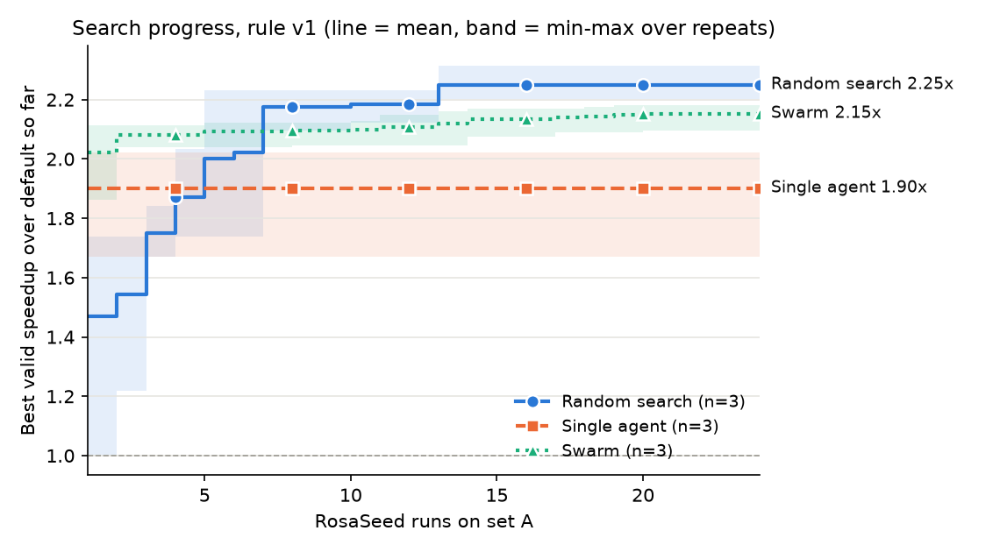
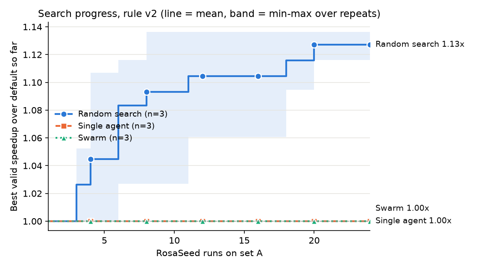

# rosaseed-swarm

**When does coordinating LLM agents help tune scientific software? A controlled study on a
genomics aligner.**

This repository is a controlled comparison of three ways to tune a DNA read aligner under an
identical budget of 24 alignment runs: a coordinated team of LLM agents (a planner, three
explorers working in parallel through a shared results store, and a critic), a single
tool-using LLM agent, and random search. Every result is validated on held-out reads with
paired timing against the default, every agent claim is checked against the raw results
log, and the critic is tested with planted false claims. All agents run on a local open
model (`qwen3:8b`, one consumer GPU), so the whole study reproduces from this repository at
no cost.

The aligner is [RosaSeed](https://github.com/smgandhi-18/RosaSeed), my seeding framework
for BWA-MEM2 (preprint release, commit `865bec6`), tuned over ~230,000 configurations
(20 compile-time builds × 4 runtime options) on simulated reads from human chromosome 22
(T2T-CHM13v2.0).

**What is in here**

- An agent harness with tool calling, a shared SQLite results store, a CPU-pinned run
  queue with timeouts, retries, caching and resume, and a pluggable LLM backend.
- An evaluation protocol: equal budgets, three seeded repeats, held-out validation with
  alternating default/candidate timing, a measured noise floor, and deterministic labelling
  of every claim.
- Two rounds of experiments, a planted-error test of the critic, two follow-up ablations
  (planner with and without the validity rule; tool-level refusal of repeated runs), all
  agent transcripts, and a record of how the code was verified ([VERIFICATION.md](VERIFICATION.md)).

## Findings in short

1. **Coordination stopped the agents from getting stuck, but did not beat random search.**
   With `qwen3:8b`, the single agent re-ran its first configuration for most of its
   budget in all six attempts (1 to 7 distinct configurations out of 24). The swarm's
   explorers, each confined to a region, tried 17 to 23. Random search tried 24 and found
   the best configurations in both rounds.
2. **Every method exploited a loophole in the first accuracy rule.** Round 1 reported
   configurations about 2× faster than default RosaSeed "at equal accuracy". They were
   not: a low `--rs-cap` turns ambiguous repeat reads into confident guesses, and those
   configurations made 1,800-3,500 confidently wrong placements on held-out reads against
   628 for the default. The analysis caught it because it reports confident errors even
   though the rule did not count them.
3. **With the loophole closed (round 2), the real headroom is about 9 %, and the plan
   trapped the swarm.** Random search found a valid configuration in 3 of 3 repeats
   (1.08-1.10× on held-out reads); the swarm and the single agent in 0 of 3. Every valid
   configuration needs `--rs-cap` 2000 or 5000, and the planner, even when told the rule,
   kept all three explorers at cap 500 or lower in every repeat. A first round-2 run in
   which I had left the rule out of the planner's prompt did no better (1 of 3).
4. **The LLM critic was not a reliable verifier.** Against planted false claims it
   rejected 3 of 9 in round 1, with verdicts that did not depend on the truth, and
   fabricated confirmations such as "claimed config was run" for a configuration that
   never ran. In the first round-2 run it rejected every invalid claim, because the
   held-out tool returned an explicit `valid_B: false`, but it still let a planted
   inflated speedup through. With the rule added to its prompt it ran its checks and then
   stalled without deciding in 4 of 6 runs. Deterministic checks caught every error in both
   rounds.

## The question

With an equal budget of 24 RosaSeed runs per attempt and 3 repeats:

1. **Search quality.** Which method finds the fastest configuration that stays accurate
   on held-out reads: a swarm (planner + 3 parallel explorers + critic), a single
   tool-using agent, or random search?
2. **Reliability.** Are the agents' reported results true, and does the critic catch the
   ones that are not?

## Setup

| | |
|---|---|
| Reference | T2T-CHM13v2.0 chromosome 22 (GenBank CP068256.2, 51.3 Mbp) |
| Reads | wgsim, 2×150 bp, 100,000 pairs per set, 1 % error; set A (seed 11) for search, set B (seed 22) held out |
| Aligner | RosaSeed preprint code in BWA-MEM2: 20 prebuilt binaries (compile-time flags) × 4 runtime options, ~230,000 configurations |
| Baseline aligner | stock BWA-MEM2 built from the same source tree |
| Budget | 24 alignment runs on set A per condition and repeat; 3 repeats (seeds 1, 2, 3) |
| Model | `qwen3:8b` through Ollama 0.40.16, the same model and temperature (0.7) for every agent role |
| Hardware | AMD Threadripper PRO 5965WX (24 cores, 4 dies of 6), 310 GiB RAM, NVIDIA RTX 3060 12 GB |

**Search space.** Compile time: pre-chain singleton filter (off, or trigger 50/200 ×
weak length 60/80), strand choice (`ENABLE_F_RC_CHOICE`) on/off, Phase C early exit on/off.
Runtime: `-k` 15..25, `--rs-cap` {50, 100, 200, 500, 1000, 2000, 5000}, `--rs-gap` 1..15,
`--rs-gap-step` 1..10. The default is the preprint's recommended configuration
(`t200w60`, both flags on, k 19, cap 2000, gap 5, step 4).

**Conditions.**

- *Random search*: 24 uniform samples.
- *Single agent*: one tool-calling agent with `get_search_space`, `run_rosaseed`,
  `read_log` and `submit_claim`.
- *Swarm*: a planner splits the space into 3 regions (JSON); 3 explorers search their
  regions concurrently (8 runs each) through one run queue and a shared results log; each
  submits a claim; a critic checks the claims against the log, may re-run up to 3 on
  held-out set B, and accepts or rejects each. The swarm's answer is the fastest accepted
  claim.

**Fair timing.** RosaSeed speed is what is measured, so:

- the model runs 100 % on the GPU, its few CPU threads pinned to another die;
- every alignment runs pinned to one 6-core die (`taskset -c 6-11`, `-t 6`), one at a time,
  under a file lock. Calibration: a second alignment on the neighbouring die adds 0.10 s
  (more than 2 SD), so runs are serial;
- model generation on the GPU during an alignment slows it by 0.6 % (6.64 → 6.68 s,
  `results/llm_overlap.json`), below the 1 % noise floor; this affects only swarm set-A
  timings, against the swarm, and none of the held-out numbers;
- conditions never share cached results; the condition order is shuffled per repeat in
  round 2.

**Accuracy rules.** A read is correct when its primary alignment is within 20 bp of the
wgsim truth. *Accuracy* counts reads that are correct and have MAPQ > 0, over all reads,
because MAPQ-0 reads (about 12 %, repeats) are placed almost at random.

- *Rule v1*: valid if accuracy is at most 0.05 points below BWA-MEM2's on the same reads.
- *Rule v2* (added after round 1 exposed the loophole, before any round-2 run): also,
  confident errors (MAPQ > 0, wrong place) at most default RosaSeed's + 100
  (617 on set A, 728 on set B).

**Scoring, computed from the results store and never from agent claims.**

- *Search quality*: the 3 fastest valid configurations on set A are re-run 3 times each on
  held-out set B, alternating with default RosaSeed (D, C, D, C, D, C); speedup is the
  ratio of medians; the noise floor is 2 SD of all those default runs. The reported value
  is the fastest candidate valid on B and above the floor (1.000 if none).
- *Reliability*: each claim is labelled with the same rules the critic was given (config
  run, numbers within 0.01 of the log, valid, speedup above 1.007) plus validity on B.

## Results

Baselines (set A, 6 threads): BWA-MEM2 11.70 s, default RosaSeed 6.83 s; accuracy 87.753 %
and 87.760 %; confident errors 349 and 517.

### Round 1, rule v1 (`results/summary.md`)

| | Distinct configs tried | Speedup on held-out B, mean (min-max) | Confident errors on B (final config) |
|---|---|---|---|
| Random search | 72 of 72 | 2.18× (2.13-2.25) | ~3,500 |
| Swarm | 63 of 72 | 2.09× (2.04-2.12) | ~3,300 |
| Single agent | 3 of 72 | 1.84× (1.62-1.96) | ~2,600 |
| *Default RosaSeed / BWA-MEM2* | | *1.00×* | *628 / 431* |

These speedups are not at equal quality (finding 2). Across all 227 configurations ever
run, confident errors fall steadily as `--rs-cap` rises: cap 50 ≈ 3,000-3,500,
200 ≈ 2,000, 1000 ≈ 1,000, 2000 and 5000 ≈ 500.



### Round 2, rule v2 (`results/v2/summary.md`)

| | Distinct configs tried | Repeats with a valid config | Speedup on held-out B, mean (per repeat) |
|---|---|---|---|
| Random search | 72 of 72 | 3 of 3 | **1.09×** (1.10, 1.08, 1.10) |
| Swarm, planner told the rule | 61 of 72 | 0 of 3 | 1.00× |
| Swarm, planner not told (first run, `results/v2_uninformed/`) | 63 of 72 | 1 of 3 | 1.02× (1.00, 1.00, 1.06) |
| Single agent | 15 of 72 | 0 of 3 | 1.00× |

Valid configurations exist only at `--rs-cap` 2000 or 5000. The planner's cap ranges with
the rule in its prompt were {50-100, 100-200, 200-500}, {50-100, 200-500, 100-200} and
{50-100, 100-500, 200}; without it, {50-100, 100-200, 200-500}, {50-100, 200-500, 500-1000}
and {50-100, 200-500, 1000-2000}. Only the last plan reached a valid region, and it is the
only swarm repeat that succeeded. The best configurations random search found keep the cap
at 2000-5000 and use the earlier pre-chain trigger (`t50w60`) with longer seeds (k 23-25).

Round-2 random search used the same seeds as round 1, so it re-scored the same 72
configurations under the new rule rather than drawing new ones. 17 of those 72 uniform
draws (24 %) are valid, so 24 draws contain at least one valid configuration with
probability 1 − 0.76^24 > 99 %: its 3 of 3 is what chance predicts.



### Reliability and the critic

| | Round 1 | Round 2, planner/critic not told the rule | Round 2, told |
|---|---|---|---|
| Agent claims wrong or missing | single 0 of 3, swarm 2 of 9 | single 3 of 3, swarm 8 of 9 | single 3 of 3, swarm 9 of 9 |
| Critic on real claims: caught / missed / false alarm / undecided | 1 / 1 / 2 / 0 | 8 / 0 / 0 / 0 | 0 / 0 / 0 / 9 |
| Swarm answer valid: without critic → with critic | 3 → 3 of 3 | 0 → 1 of 3 | 0 → 0 of 3 |
| Planted false claims rejected (`critic_probe.py`) | 3 of 9 | 2 of 3 | not testable (no valid run to plant from) |

In round 2 the agents claimed their fastest configuration even when every result said
`valid: false`. In the round-1 planted-error test the critic's verdicts did not track the
truth: in one repeat it rejected every claim with the same false reason ("speedup below
1.007" for claims of 1.9-2.1×); in the other two it accepted every claim, planted ones
included, with invented confirmations. In the first round-2 run it relayed the held-out
tool's explicit `valid_B: false` and got every real claim right, but still accepted a
planted inflated speedup. With the rule added to its prompt it ran `read_log` and three
held-out checks and then answered with empty text until the turn limit, in all three
repeats; my reminder message told it to call `submit_claim`, a tool it does not have
(fixed afterwards: the reminder now names `decide`). Its final answer, "nothing valid",
was correct only because no claim was accepted.

### Follow-up: refusing exact repeats (`results/v2_followup_norepeat/`)

The single agent repeated itself, so in a follow-up the tool refused an exact repeat
without using up a run (round-2 rule).

| | Runs used (of 72) | Repeats with a valid config |
|---|---|---|
| Single agent, repeats refused | 22 | 0 of 3 |
| Swarm, repeats refused, planner told the rule | 70 | 0 of 3 |
| Swarm, repeats refused, planner not told | 71 | 1 of 3 (1.06×) |

Refusing repeats did not make the single agent explore: it kept proposing the same
configuration, was refused, and ran out of turns with most of its budget unused. A rule in
a tool can stop wasted runs but cannot give the model a new idea.

## When coordination helped, and when it did not

- **Helped:** splitting the budget into regions forced exploration. The swarm tried 63
  distinct configurations per round against the single agent's 3 and 15.
- **Did not help:** on this space a good configuration is easy to hit by chance (round 1)
  or sits where an LLM's prior ("lower cap = faster") steers it away from (round 2). Random
  search has no prior to be wrong about.
- **Hurt:** a plan made once, before any evidence, and enforced as hard region limits,
  propagated one wrong assumption to every explorer, in all three repeats even with the
  rule in the planner's prompt. Knowing the rule is not knowing which setting breaks it.
  The fix is to let the planner re-plan from early results, or to make regions soft.
- **The critic helped only with a tool-grounded verdict**, and it was fragile: a longer
  prompt plus a wrong reminder made it stop deciding altogether.

## Limitations

- One small genome and simulated reads. Speedups here are RosaSeed tuned against RosaSeed
  default on chr22, not comparable with the preprint's whole-genome comparisons against
  other aligners, and not a recommendation for real data.
- 3 repeats and a 24-run budget per condition: enough for large effects (an agent stuck,
  a trapped swarm), not to rank methods that differ by a few percent.
- One 8B local model. A larger model may not get stuck or fabricate checks. Sampling is
  seeded, but GPU inference is not bit-for-bit deterministic.
- Set-A speedups (plots, the agents' view) use the calibration-time default as reference,
  which drifted by about 2.5 % between calibration batches; the held-out numbers use a
  default timed in alternation with each candidate.
- Rule v2 was designed after seeing round 1; round 2 was then run in full under it, with
  the agents told only the rule, not which settings break it.
- Round 2 reused round 1's random-search seeds (paired re-scoring, not a new sample).
- The first round-2 swarm ran without the rule in the planner's and critic's prompts (my
  omission, found by review); it is kept as `swarm-v2-uninformed` and the swarm was rerun.

## Future work

- Adaptive planning: the planner re-splits the space after the explorers' first runs.
- A larger model (for example `qwen3:14b` on the same GPU) to see which failures are about
  model size.

## Reproduce

Linux with `gcc`, `make`, `git`, `curl`, `zstd`, `wgsim`, GNU `time`, `taskset`, Python 3.11+
and an NVIDIA GPU with about 8 GB free. Data and binaries go under `work/` (about 12 GB).

```bash
python3 -m venv .venv && .venv/bin/pip install -r requirements.txt
setup/get_rosaseed.sh          # clone RosaSeed at commit 865bec6
setup/build_binaries.sh        # stock BWA-MEM2 + 20 RosaSeed variants
setup/get_data.sh              # chr22 from NCBI, wgsim read sets A and B
setup/build_indexes.sh         # BWA-MEM2 index + RosaSeed 2-step index (14 nt jump table)
setup/get_ollama.sh && setup/start_ollama.sh
OLLAMA_HOST=127.0.0.1:11435 work/ollama/dist/bin/ollama pull qwen3:8b

.venv/bin/python -m pytest -q                       # 74 unit tests
.venv/bin/python scripts/calibrate.py               # baselines + timing noise

# round 1 (rule v1)
.venv/bin/python scripts/run_experiment.py --fixed-order
.venv/bin/python scripts/analyze.py
.venv/bin/python scripts/critic_probe.py

# round 2 (rule v2; the rule is read from the "-v2" in each condition name)
.venv/bin/python scripts/run_experiment.py --rule v2
.venv/bin/python scripts/analyze.py --conditions random-v2 single-v2 swarm-v2 --out results/v2
.venv/bin/python scripts/critic_probe.py --condition swarm-v2
.venv/bin/python scripts/measure_llm_overlap.py

# follow-up: exact repeats refused without cost
.venv/bin/python scripts/run_experiment.py --rule v2 --conditions single-norepeat swarm-norepeat
.venv/bin/python scripts/analyze.py --conditions single-norepeat-v2 swarm-norepeat-v2 \
    --out results/v2_followup_norepeat
```

Round 1 in this repo ran with the original fixed order (random, single, swarm). The
`*-uninformed` conditions in `results/` come from the code before the planner and critic
were given the round-2 rule (commit `e119cbb`). CPU sets are in `config.yaml`; change them
to match your machine. All scripts resume after an interruption.

## How the agent-written code was verified

The harness was written with Claude Code (an AI coding agent) under my direction, so each
part was checked independently of the agent that wrote it: unit tests against inputs with
hand-computed answers (for example a 12-record SAM file for the evaluator), a dry run whose
transcripts were read end to end, and a separate read-only review of the whole repo by a
fresh reviewer, whose findings and fixes are listed. Every bug found, what found it, and
how it was fixed is in [VERIFICATION.md](VERIFICATION.md). All agent transcripts are in
`results/transcripts/`.

## Layout

```
swarm/      search space, evaluator, runner, store, run queue, metrics, tools, LLM interface
agents/     agent loop, prompts, the three conditions
scripts/    calibrate, run_experiment, analyze, critic_probe, measure_llm_overlap
setup/      download, build and model scripts
tests/      pytest suite
results/    round 1 tables and plot; v2*/ round 2 and follow-ups; transcripts/ every agent conversation
```

## License

MIT (see `LICENSE`). RosaSeed and BWA-MEM2 keep their own licenses.
